# B.O.T.S

A little robot at the top of your screen that keeps an eye on your [Boite](https://github.com/beboite/boite) agents. It shows what they are doing, tells you when one of them needs you, and lets you talk to them without opening Boite's window. It also runs your scheduled missions, keeps your to-do list and, on Windows, puts the computer at hand: its system, wallpapers, clipboard and apps.

<p align="center">
  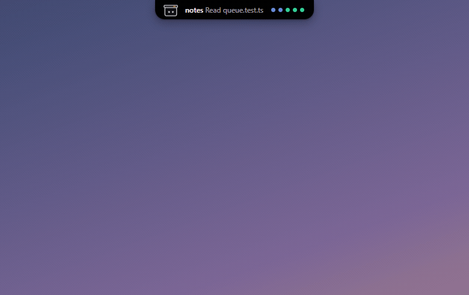
</p>

B.O.T.S is a Boite plugin with its own window. Its code, its repository and its plugin id call it Bots (`bots`). Boite installs it, starts it, and hands it the address of the Boite core and a token to talk to it. When you quit Bots from its tray icon, it stays stopped until Boite starts it again.

The pictures below come from the [demo mode](#demo-mode), on Boite's fake core.

## What it does

### Every session at a glance

Point at the pill and the island opens as a deck of tabs. **Threads** lists every conversation running in Boite, however many there are, including those running on your other machines. Sub-agents fold under the conversation that started them. A click opens the thread in Boite.

<p align="center">
  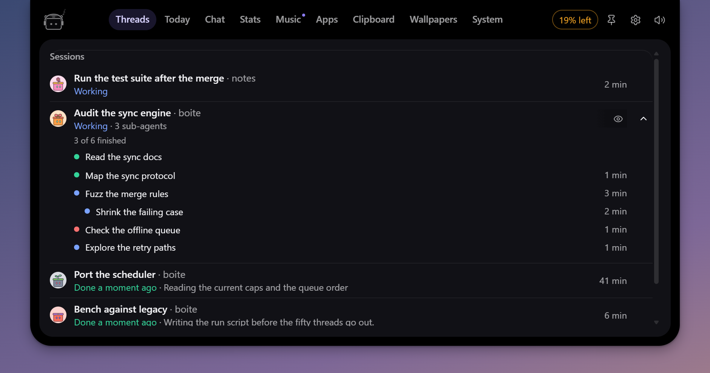
</p>

### Answer from the island

When an agent asks for a permission or has a question, the pill says so. Open it to allow once, always allow or deny, pick an answer or type your own, without leaving what you are doing.

<p align="center">
  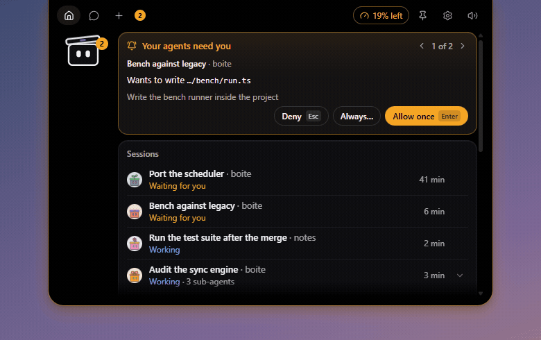
</p>

### One tab for each thing

<p align="center">
  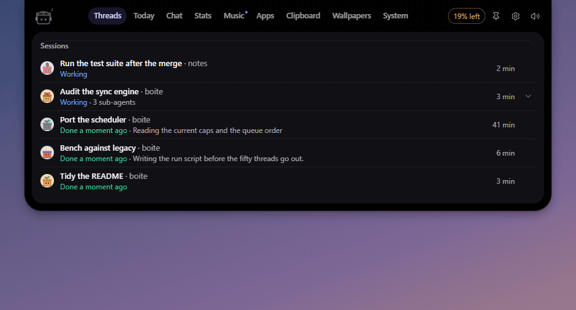
</p>

- **Threads**: the sessions at work and the requests waiting for you.
- **Today**: the clock and the week, the next scheduled mission, your to-do list, a focus timer and the day's numbers.
- **Chat**: your conversation with B.O.T.S.
- **Stats**: each subscription's quota windows and when they reset, the threads finished today with their files, time and tokens, and the memory your agents hold.
- **Music**: the player, with the words.
- **Apps**, **Clipboard**, **Wallpapers** and **System**: your computer, on Windows.

### Ask B.O.T.S

Call B.O.T.S from any app with its shortcut, or click a robot on the desktop, and ask. B.O.T.S answers as one of your Boite agents, with its own conversation and memory, and you follow its work in the chat tab as it goes. It also keeps reminders ("remind me at 6 pm to call Paul"), timers and stopwatches, your to-do list and your missions.

<p align="center">
  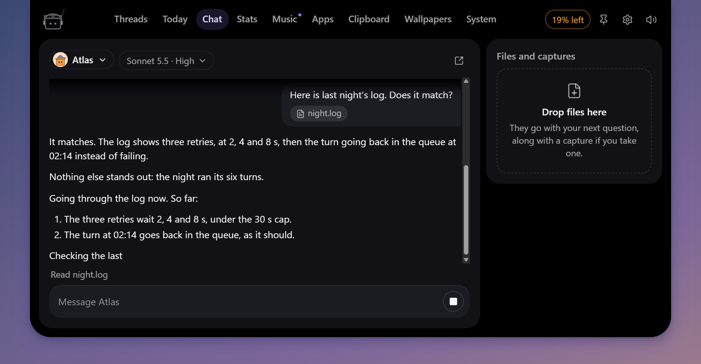
</p>

### Missions and the to-do list

Ask B.O.T.S for a mission ("every weekday at 9, check the website's broken links") and it starts that thread in Boite at that time: once, every day, on weekdays or once a week. Boite's core has no scheduler, so missions live in Bots and run while it runs. One whose time passed while the computer slept runs when it wakes, if it is less than 12 hours late. **Today** shows the next one and marks the days they run.

The to-do list belongs to no thread. Tick it in **Today**, or ask B.O.T.S to add, rename, tick or clear items ("add renew the domain to my list").

<p align="center">
  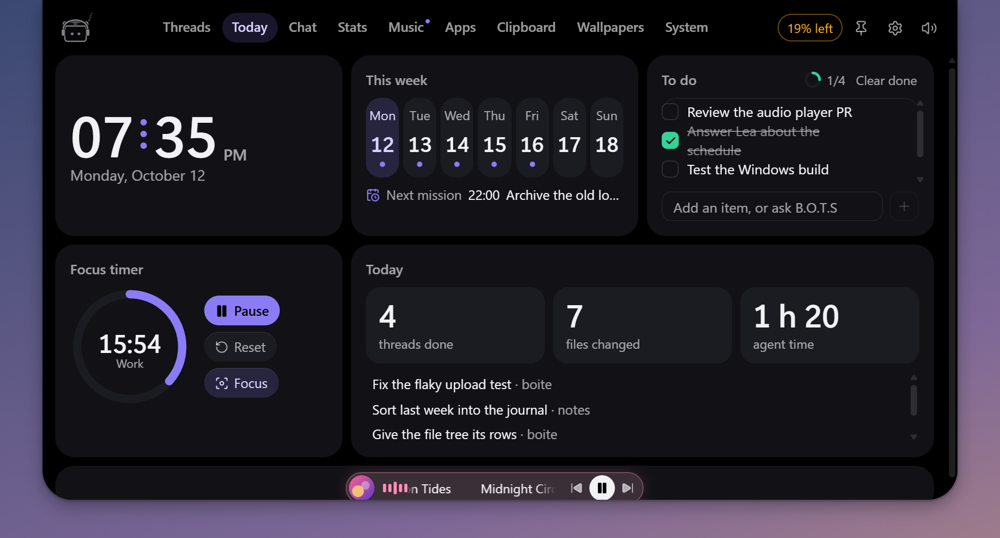
</p>

### While you were away

Come back to the keyboard after a quarter of an hour or more, and the island tells what happened meanwhile, a line each: the threads that wait for you, those that finished or failed, the pull requests whose CI settled, the reminders that rang, a quota running low and the memory guard's warnings. A click on a line opens it.

<p align="center">
  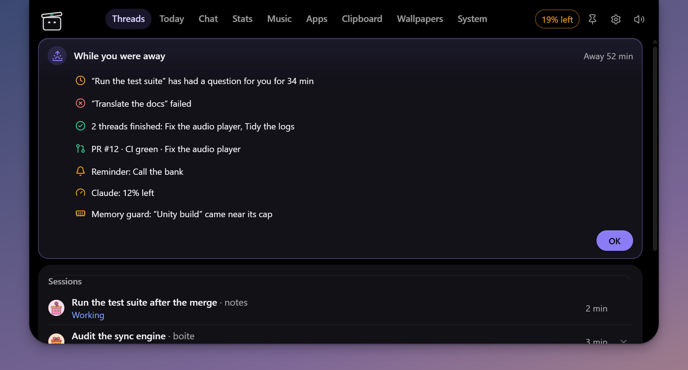
</p>

### Your computer

On Windows, four tabs reach the computer itself. Nothing in them changes the computer until you click, and the heavy actions ask first.

- **System**: CPU, memory, drives and uptime, the busiest processes, and a way to close one. Lock, sleep, restart and shut down. B.O.T.S never closes the system's processes, Boite, itself or your agents.
- **Wallpapers**: Windows' recent wallpapers, or a folder of yours, for every screen. With [Wallpaper Engine](https://www.wallpaperengine.io) installed, its wallpapers too, screen by screen, with play, pause, mute and next.
- **Clipboard**: what you copied, text and images, the last 30. Kept in memory only: never written to disk, gone when Bots quits. What password managers mark as private is left out. A click copies an entry back, or sends it to the chat.
- **Apps**: the Start menu's apps, searchable, opened in a click.

| System | Wallpapers |
| :---: | :---: |
| 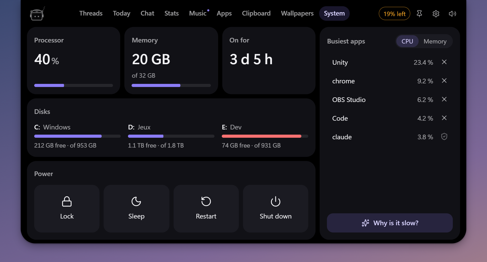 | 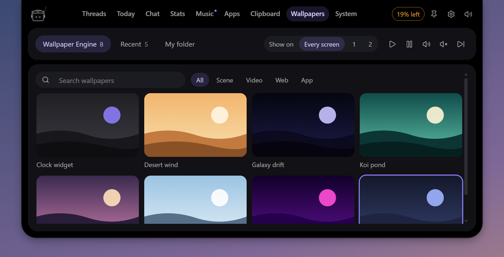 |
| **Clipboard** | **Apps** |
| 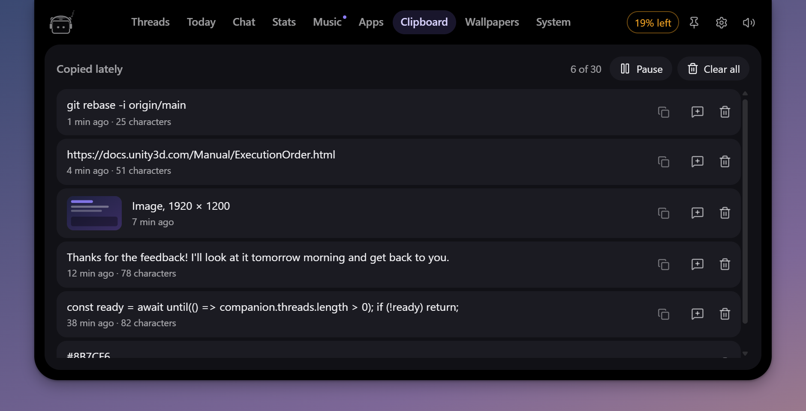 | 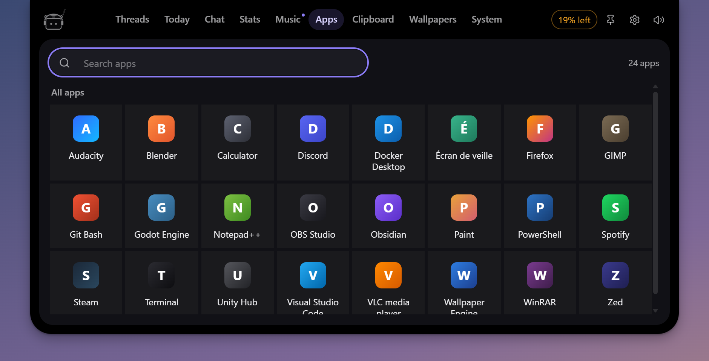 |

### Robots on the desktop

Rather have them loose? Put up to four robots on the desktop, each one of your Boite agents with its own look. Click one for its panel: ask it something, start a pomodoro, turn on focus, or see what is at work. Drag a robot out of the island to set it loose, and back to the top edge to put it back.

<p align="center">
  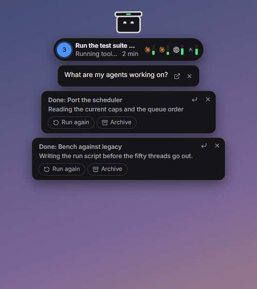
</p>

### Music, with the words

On Windows, when something plays (Spotify first, else whatever Windows calls current), the robot puts on its headphones and dances, and the player sits beside the pill and in the **Music** tab: cover, controls, timeline and synced lyrics. The lyrics come from [LRCLIB](https://lrclib.net), which receives the title and the artist of each track, nothing else. Both can be turned off in Settings.

<p align="center">
  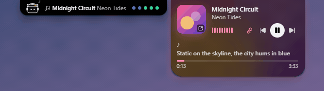
</p>

### The pill at rest

Closed, the island is a small pill. Pick what it shows when nothing needs you: the thread at work and what it does, the quota with the least left, the song playing, or only the robot. Turn the mouse wheel over the pill to go from one to the next.

<p align="center">
  
</p>

A pomodoro or a timer sits beside it.

<p align="center">
  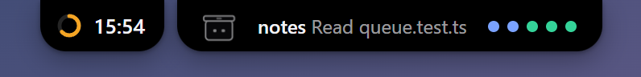
</p>

### And the small things

- **Focus.** While a pomodoro runs its work phase, finished threads wait for the end and the sounds stay off, except agents that need you and reminders.
- **Waiting threads.** When threads have waited for you too long (a permission, a question, an answer you have not read), B.O.T.S says so and opens the first one on a click.
- **Pull requests.** When a thread opens a pull request, the island follows its CI until it passes or fails.
- **Memory.** Before Boite's memory guard stops an agent, the island warns you.
- **Boite updates.** A new Boite version or nightly shows in the island, with a way to install it from Boite.
- **Full screen.** B.O.T.S steps aside while a game or a video fills its screen, and comes back after. The shortcut still calls it.
- **Sounds.** Short chimes when an answer comes, an agent needs you or a reminder rings.

### Settings

Everything else is in **Settings**, from the tray icon: where the robots sit and on which screen, the shortcut, what the pill shows, the mascot and the agents on screen, quotas, pomodoro, missions, sounds and reminders. In English and French.

<p align="center">
  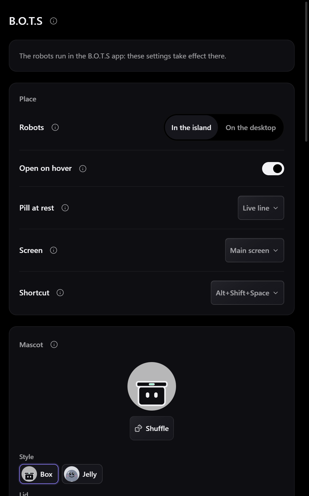
</p>

## Install

In Boite, open **Settings > Plugins**, add `https://github.com/beboite/bots`, and confirm. Boite downloads the executable for your system from this repository's releases, checks its sha256 against [`boite-plugin.json`](boite-plugin.json), and starts it.

The tray icon has **Settings** and **Quit**.

## Running it by hand

Bots finds the core in this order:

1. `BOITE_CORE_URL` and `BOITE_TOKEN`, which Boite sets when it starts Bots.
2. `core.json` in Boite's data folder (`BOITE_DATA_DIR`, else `%LOCALAPPDATA%\boite2`, `~/Library/Application Support/boite2` or `$XDG_DATA_HOME/boite2`), read the way Boite's CLI reads it.
3. Neither: the robots wait, say "Start Boite to wake the bots", and look again every few seconds.

A second launch brings the running Bots forward instead of starting another one.

## Development

Bots is Tauri 2, Svelte 5, Vite and TypeScript, built with [Bun](https://bun.sh) (the version in `package.json`'s `packageManager`) and stable Rust. On Linux, install the WebKit dependencies first: `libwebkit2gtk-4.1-dev libayatana-appindicator3-dev librsvg2-dev`.

```sh
git clone --recurse-submodules https://github.com/beboite/bots
cd bots
bun install --frozen-lockfile
bun run check          # svelte-check, then the scripts' types
bun run test           # vitest
bun run test:scripts   # the release scripts
bun run check:manifest # boite-plugin.json against Boite's own reader
cd src-tauri && cargo test && cargo clippy --all-targets -- -D warnings
```

### Demo mode

The demo runs the robots on Boite's in-memory fake core: no Boite needed.

- In a browser: `bun run dev`, then open `http://localhost:5174/?fake=1` (add `&hud=1` for busy agents and quotas, or open `?view=settings&fake=1` for the settings).
- In the desktop window: `BOTS_DEMO=1 bun run tauri dev` (`BOTS_DEMO=hud` for the busy version). Development builds only.

In the browser, a few more parameters set a scene for captures: `pose=collapsed|peek|open|deck|desktop|away`, `tab=threads|today|chat|stats|music|apps|clipboard|wallpaper|system`, `calm=1` to answer the starting requests, `music=playing&lyrics=1`, `rest=live|quota|music|timer|robot`, `timer=1`, `todo=1`, `mission=ask|list`, `source=engine|recent|folder` for the wallpapers, and more. [`src/lib/island/pose.ts`](src/lib/island/pose.ts) lists them all. The pictures of this README were taken that way, with the English interface.

### Against a throwaway core

Never point a development build at the Boite you use every day. Start a core from the submodule on a fresh data folder instead:

```sh
cd vendor/boite && bun install --frozen-lockfile && cd ../..
scratch=$(mktemp -d)
BOITE_ECHO=1 BOITE_HOST_AGENTS=0 bun vendor/boite/packages/core/src/main.ts --port 0 --data-dir "$scratch"
# in another terminal: Bots reads that core's core.json
BOITE_DATA_DIR="$scratch" bun run tauri dev
```

Stop the core before deleting `$scratch`.

### The `vendor/boite` submodule

Bots shares Boite's protocol types and UI pieces (the client, the theme, i18n, the chat renderer) instead of copying them: `vendor/boite` is a shallow submodule of Boite, and the build aliases `@boite/contracts` and `@boite/ui/*` into it (`vendor.config.ts`, `tsconfig.json`). Bots keeps its own robots, faces, sounds, the companion's code and its own `strings.en.ts` and `strings.fr.ts`.

A submodule rather than a package: Boite publishes no packages, and pinning a commit keeps Bots building against exactly the protocol it was tested with.

To move to a newer Boite:

```sh
cd vendor/boite
git fetch --depth 1 origin <commit>
git checkout <commit>
cd ../..
bun run check && bun run test && bun run check:manifest
git add vendor/boite
git commit -m "chore(vendor): bump boite to <short commit>"
```

Check the protocol version and the RPCs Bots calls (`ui.reveal` among them) when you bump.

## Releasing

1. Run the **Release** workflow from the Actions tab with the version, without the `v` (`0.2.0`).
2. It builds raw executables with `tauri build --no-bundle`: `bots-x86_64-pc-windows-msvc.exe`, `bots-aarch64-apple-darwin`, `bots-x86_64-apple-darwin`, `bots-x86_64-unknown-linux-gnu`, and the arm64 Windows and Linux ones when those runners succeed. It publishes them, with `SHA256SUMS.txt`, as release `v<version>`.
3. It then pushes the branch `release/v<version>`, where `scripts/release-manifest.ts` has written the version, the URLs and the sha256 into `boite-plugin.json`, and opens a pull request from it. Boite offers the new version once that pull request is merged.

If the repository does not let GitHub Actions open pull requests, the last step fails after the push: open the pull request from `release/v<version>` by hand, after checking each URL and sha256 against the release's assets.

## Contributing

Pull requests are welcome. Every change to `main` goes through a pull request and needs a maintainer's approval before it is merged. CI runs the typecheck, the tests, the manifest check, and `cargo test` and clippy on Windows and Linux. [AGENTS.md](AGENTS.md) lists the rules the code follows.

## License

MIT, see [LICENSE](LICENSE).
